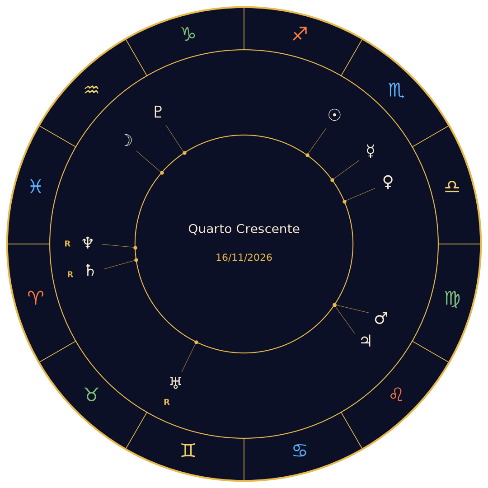

# Astro Pipeline

Pipeline em Python que utiliza efemérides astronômicas da NASA/JPL para calcular posições planetárias, detectar retrogradações, determinar fases da Lua e gerar visualizações automáticas.

> Projeto em andamento. Feito para o público que está começando na astrologia, com foco em **ciclos de evolução e livre-arbítrio**, nunca em previsões fatalistas.

## Por que este projeto existe

- Muito conteúdo de astrologia é superficial e determinista ("vai acontecer X").
- IAs generativas tendem a inventar símbolos e textos quando desenham mapas sozinhas.
- Aqui, tudo que precisa ser **exato** (posições dos planetas, gráfico) é calculado e desenhado por código. A IA entra só onde faz sentido: apoio ao roteiro, sempre com revisão humana.

## O que já funciona

- `src/ceu.py`: calcula a posição dos planetas, a retrogradação e a fase da Lua para qualquer data, usando as efemérides da NASA (JPL) pela biblioteca Skyfield.
- `src/grafico.py`: desenha a roda do zodíaco com os planetas na posição correta, retrógrados marcados e fase da Lua no centro.



## Próximos passos

- [ ] Roteiros baseados em conteúdo autoral, com regras contra determinismo
- [ ] Linha do tempo dos ciclos de idade
- [ ] Narração com síntese de voz
- [ ] Montagem do vídeo 9:16 com aviso de que há IA no processo

## Como rodar

Requer Python 3.12.

```powershell
python -m venv .venv
.venv\Scripts\Activate.ps1
pip install skyfield matplotlib
python src\ceu.py
python src\grafico.py
```

O gráfico é salvo em `output/grafico_hoje.png`.

## Princípios

- **Sem determinismo:** o conteúdo fala em potencial e convite, não em destino.
- **Transparência:** vídeos com IA terão aviso.
- **Autoria:** os textos são escritos pela autora, em suas próprias palavras.
